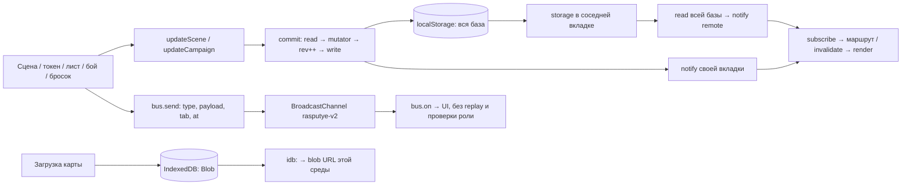
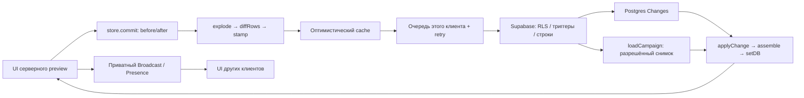

# TASK-035: аудит синхронизации «Распутья»

Исторический срез 30.10.2026. Актуальное продолжение после PR #126: [аудит 31.10](task-035-network-followup-2026-10-31.md).

Дата: 2026-10-30, Asia/Dushanbe (+05:00). Автор: Яра + Codex (`codex/network`).
Issue: [#57](https://github.com/YGXVI/tavern/issues/57). Draft PR: [#59](https://github.com/YGXVI/tavern/pull/59). Статус: аудит подготовлен; план дальнейшей работы `proposed`, согласование пересечений ожидается.

## Срез и границы доказательств

- Отдельный checkout: `/Users/yar/Documents/ChatGPT/PetProject/network`; чужие рабочие копии не переключались.
- Исходная база: `ebe7c75f4243ed737275c5035a27d57b038a5f55`; от неё создана и опубликована `codex/network`. Во время аудита коллега влил PR #58. Ветка без сброса догнана fast-forward до актуальной базы `a9c92e61e046b73eef647f5af87bd8cebaae3250`.
- Начальный срез активной реализации: `origin/claude/dev` = `445582b95bd7c8cfb128d253d09205c04c9cf467`. Историческая ветка `claude/task-002-supabase-backend` = `75c50cbe13eb786076efbab1d1cdada7203b2920` содержит план, а не последний код.
- Прочитаны AGENTS, open-spec, status, data, decisions, vision/glossary, относящиеся к столу текущие specs и активный change TASK-002, Issues #8/#56 и обсуждение PR #9. Поиск открытых PR на момент среза дал пустой результат. Поиск Issues не заменяет проверку веток.
- `npm ci` успешно. Исходный main: validate 17/17, архив 24/24, тесты 24/24. После PR #58 и добавления этого change: validate 18/18, архив 25/25, тесты 35/35. VM-прогон повторён на новой базе с теми же результатами.
- **Эксперимент** ниже — выполнение неизменённого `store.js` в Node VM с синтетическим хранилищем и управляемым чередованием. Это не настоящий браузер, не два устройства и не измерение частоты гонки.
- **По коду** — статический вывод; **не проверено** — нужен запуск сценария. Живой Supabase, настройки проекта, применённые миграции, OAuth, RLS и устройства самостоятельно не проверялись.
- Попытка Playwright остановилась до сценариев: Chromium отсутствует. Браузер GitHub использовался для координации, не для игровых проверок.

## Песочница: режим по умолчанию в актуальном main

После PR #58 в main есть два пути: песочница по умолчанию и серверный preview через `?server=1` (выключение `?server=0`). Общий `SERVER_ENABLED = false`. Серверный путь описан отдельно ниже; его наличие не доказывает пройденную живую сессию.

В песочнице между устройствами общая кампания **не передаётся**. `dist/js/core/store.js` в локальном режиме хранит базу целиком в `localStorage`; уведомления соседних вкладок через `storage`, мгновенные действия через `BroadcastChannel('rasputye-v2')`. Нужны одинаковые origin и профиль/раздел хранилища браузера. Другой профиль, браузер или устройство имеют независимые данные. Одинаковая демо-кампания на двух устройствах — два независимых seed, а не доказательство связи; использовать новую кампанию и уникальный маркер.

| Данные/действие | песочница: реализация по коду | Между устройствами |
| --- | --- | --- |
| Кампания, членство, приглашение | общий объект `rasputye-v2-db`, локальный поиск кода | нет |
| Активная/личная сцена, токены, листы, бой, журнал | `updateCampaign/updateScene → commit → storage → subscribe` | нет |
| Пинг/камера, drag, линейка, шаблон, цель, тост броска | BroadcastChannel; UI фильтрует cid/sceneId, не сервер | нет |
| Результат броска | вычислен клиентом; полный entry в журнал и Broadcast; UI скрывает число | нет |
| Присутствие | локальная Map, heartbeat 4 с, удаление чужих записей старше 11 с при обходе раз в 3 с | нет |
| Загруженная карта | Blob в IndexedDB `rasputye-v2-assets`, ссылка `idb:`; встроенные карты статические | нет |
| Личность и права | userId в sessionStorage, роль в локальном membership; произвольный выбор демо-пользователя | нет авторизации |
| Offline/reconnect | чтение localStorage при старте; серверной очереди/подтверждения/восстановления нет | не реализовано |

`/legacy/` — отдельный локальный прототип, не альтернативный сетевой режим.

## Карта потока данных



`commit` перечитывает базу перед мутацией, но read/modify/write не является атомарной транзакцией. `rev` общий на всю базу, без compare-and-swap. `storage` перечитывает последнее сохранение, не проигрывает отдельные операции. `bus` содержит `at`, но при приёме не проверяет версию, возраст, дубликат, автора или порядок. Между записью базы и Broadcast нет общего подтверждения; тост не является доказательством сохранения. При отсутствии BroadcastChannel данные могут обновляться через storage, но мгновенные действия и присутствие исчезают.

В `main.js` проверка membership закрывает стол после исключения. `table/index.js` также проверяет членство при notify. Это UI-реакция: база с секретами остаётся доступной в localStorage. `campaign.js:updateCampaign/updateScene` не проверяют роль; демонстрационный пользователь может обойти UI.

## TASK-002: серверный preview, уже в main после PR #58

[Issue #8](https://github.com/YGXVI/tavern/issues/8) и его исходное тело отстают от ветки. [PR #9](https://github.com/YGXVI/tavern/pull/9) merged (`641ea91`), но внёс только план. Есть [комментарий владельца](https://github.com/YGXVI/tavern/pull/9#issuecomment-6515330257) о продолжении реализации. Он не подтверждает готовность и испытания текущего кода.

Коллега во время аудита влил [PR #58](https://github.com/YGXVI/tavern/pull/58): актуальный main `a9c92e61e046b73eef647f5af87bd8cebaae3250`, head пачки `30d8ee23a35e47b6e9aacac8294042306776822b`. Теперь в main есть `dist/js/server/{client,config,model,sync}.js`, изменения store/auth/main/screens, семь SQL-миграций, SQL-проверки прав и `tests/server-model.test.js`. `SERVER_ENABLED = false`; предусмотрен локальный preview override. Включать его и менять облако в этом аудите не требуется.

Поток серверного кода: UI → store (снимки before/after) → `explode/diffRows` по сущностям → оптимистический cache → последовательная очередь отправок кампании этого клиента → Supabase. Обратно: Postgres Changes → `applyChange` → сборка через 30 мс → `store.setDB`. Broadcast/Presence — приватный канал `campaign:<id>`; личный канал membership; `loadCampaign` перечитывает разрешённые строки после reconnect/отказа. Карты предусмотрены в приватном Storage через `sb:` и подписанные ссылки. Скрытые поля выделены в отдельные строки; скрытые броски редактируются перед Broadcast.

Серверный preview содержит реализацию, но успешный вход двух реальных аккаунтов, доставка на устройства, применение SQL и RLS здесь **не подтверждены**. Комментарии Issue сообщают о подготовленном Supabase и Discord; это сведения автора, а не мой независимый осмотр. В актуальном sync есть повтор сетевой операции до 8 раз с задержкой до 15 с и stamp времени операции; это очередь в памяти, не durable offline outbox. Дубли insert после повтора считаются успехом по коду 23505. Полный лист и строгий серверный туман не входят в этот этап; строгий расчёт видимости сервером явно отложен.

Ветка уже уточнила правила TASK-018: игрок может двигать видимые токены при openMovement; также добавлена игра за других героев в бою. Нельзя строить исправления на старом требовании «только свой токен». PR #58 обновил решения main: DEC-013 — порядок работы Claude, DEC-014 — Supabase/закрытие DEC-008. Старые упоминания TASK-002 в status/Issue могут отставать; исходное тело #8 всё ещё называет реализацию отсутствующей, а новый комментарий автора уже сообщает о PR #58 и статусе in_progress. Не переписывать решения без автора.

По PR #58 автор сообщает 88/88 SQL-проверок RLS, 10/10 Storage и E2E двух браузеров с fake Supabase; это результаты автора, здесь не воспроизводились. Стенд хранится в `tests/browser/server-e2e/`, запуск по инструкции в `e2e.mjs` требует Playwright/Chromium. Он не проверяет живой OAuth, сетевую семантику Supabase и две физические машины. Задачи 8.1–8.4 change TASK-002 остаются открытыми. Публикацию сайта следует подтверждать Actions отдельно от merge.



## Выявленные проблемы и вопросы проверки

| ID | Срез и основание | Результат и последствие |
| --- | --- | --- |
| N1 | песочница, эксперимент store | При A.read(rev0) → B.read/write(rev1) → A.write(rev1) теряется B даже для разных полей/объектов. Повторный read уменьшает вероятность, не гарантирует сохранность. |
| N2 | песочница, эксперимент store | При ошибке setItem появляется storage-error, но commit продолжает notify и возвращает результат: память изменена, сохранение старое. Отката нет; перезагрузка теряет правку. |
| N3 | песочница, эксперимент store | setPresence(null) отправляет bye, но не удаляет собственную запись; sweep исключает текущий tabId. В своей вкладке возможна ложная отметка «онлайн». |
| N4 | песочница, код dice.js:doRoll и store | Закрытые токены, ловушки, заметки и полный результат скрытых бросков находятся у игрока в данных; roll Broadcast также несёт полный entry. Это задокументированное ограничение демо. |
| N5 | песочница, код history.js | snapshotUndo восстанавливает массив целиком; undo/redo не проверяет версию объекта. Отмена после чужой правки того же поля может стереть её. UI-сценарий ещё не пройден. |
| B1 | серверный preview main, статический риск sync/model | Очередь локальна клиенту; send обновляет строки с JSON data без видимого CAS/version. Разные токены разделены строками, но два поля одного листа/сцены могут перезаписываться. Нужен сценарий C2/C3. |
| B2 | серверный preview main, статический риск sync | loadCampaign теперь ждёт собственную очередь и буферизует полученные события во время загрузки (исправление PR #58 учтено). При первом входе подписка всё ещё создаётся после чтения; окно до SUBSCRIBED и порядок параллельных снимков требуют проверки. applyChange не сверяет серверную версию. |
| B3 | серверный preview main, статический риск sync | hidden-ids посылается клиентом после записи; результат ch.send не проверяется/не повторяется. Потеря Broadcast при скрытии может оставить старый видимый объект до перечитывания. Не утверждается утечка нового скрытого содержимого без эксперимента. |
| B4 | серверный preview main, не проверено | Удаление membership должно закрывать UI и прекращать дальнейшее чтение, запись, Broadcast, Presence, скачивание. Отписка клиента сама по себе не доказывает отзыв доступа уже подключённого клиента или подписанной ссылки. |
| B5 | серверный preview main, код send/failed | Несколько операций выполняются по одной без общей транзакции; часть может сохраниться до отказа следующей. Перечитывание исправляет UI, но атомарность связанных изменений (бой/токен/журнал) надо согласовать и проверить. |

| B6 | серверный preview main, SQL по коду | `hero_token_ids(text)` и `visible_token_ids(text)` в миграции 090600 — SECURITY DEFINER, доступны authenticated, не проверяют членство перед выборкой. Посторонний с ID кампании потенциально получает ID токенов через RPC (включая скрытого героя в hero_token_ids). Проверить A4; поля токена этим выводом не считаются раскрытыми. |

B1–B6 — вопросы для автора TASK-002, не доказанные эксплуатационные дефекты живого Supabase. Проверка SQL не запускалась. Приоритет N4/B4 определяется безопасностью перед настоящей игрой, а не скрытием кнопок.

## Воспроизводимая программа сценариев

Подготовка: отдельная одноразовая кампания с уникальным именем `AUDIT-<время>`, мастер M, игрок P, посторонний X, два героя/токена, две сцены, секретная заметка с синтетическим маркером. Записать SHA приложения, режим, браузеры, время +05:00; не сохранять Authorization/cookies/OAuth code/JWT и сырые сетевые дампы. Для вкладок одного профиля выбрать разные демо-аккаунты; для серверного режима нужны согласованные настоящие аккаунты на двух устройствах и реализация TASK-002. Одинаковые встроенные seed не использовать как доказательство обмена.

| Сценарий | Шаги и критерий | Песочница / результат аудита | Серверный preview main / результат аудита |
| --- | --- | --- | --- |
| D1: разные устройства | M создаёт новую кампанию; P открывает её приглашение на другом устройстве; принять P; сравнить имя/ID | По коду не работает: локальный код там отсутствует. Физически не проверено | Есть код входа/членства; не проверено |
| D2: доставка сохранений | M меняет активную сцену, P двигает героя, меняет HP/заметку, M переключает ход; бросить один раз. Обе стороны сверяют ID, координаты, HP, round/turn и один ID броска после reload | Путь storage реализован; VM подтвердила последовательную доставку на уровне store. Все UI-действия не проверены | Реализован адаптер; устройства не проверены |
| D3: мгновенные события | M тянет линейку, drag, шаблон и делает ping/look; P видит, X не видит; reload не восстанавливает эфемерное | Только BroadcastChannel по коду; UI не проверен | Есть приватный Broadcast; не проверено |
| C1: разные объекты | Одновременно M двигает гоблина и P героя, 20 повторов; обе позиции должны сохраниться на обеих сторонах и после reload | Потеря одной записи воспроизведена управляемым чередованием в VM; реальная частота не измерена | Разные строки, обещание сохранности пока не проверено |
| C2: один объект | Два разрешённых клиента меняют один токен в противоположные стороны; затем HP и notes одного листа. Записать порядок подтверждений и итог после reload | Последняя запись всей базы выигрывает; UI не проверен | Проверить явную политику последней записи строки и сохранение независимых полей; не проверено |
| C3: отмена и порядок | M редактирует стену, P добавляет рисунок, M отменяет; затем два автора меняют один массив. Задержать/повторить событие, проверить отсутствие отката более новой версии | Риск snapshotUndo и отсутствие version/dedup по коду; не проверено в UI | Обработка порядка/повторов и stale snapshot не проверена |
| O1: отключение сети | Открытый стол P offline 30 с, M меняет токен/сцену/бой; P делает разрешённую правку. Нельзя выдать неподтверждённое за сохранённое | Сеть не участвует; локальная работа предусмотрена, индикации серверной связи нет. Не проверено в браузере | Есть connection по статусу канала; отказ/очередь и UI не проверены |
| O2: reconnect | Вернуть сеть P, дождаться актуального снимка; reload; проверить изменения M, отсутствие дубля броска и фантомного drag | Только локальное перечитывание при reload; серверное восстановление отсутствует | loadCampaign после SUBSCRIBED при __wasDown есть; race и актуальность не проверены |
| O3: отказ сохранения | В тестовом окружении запретить запись/quota; поменять HP; сравнить UI, память, диск, reload | VM: ошибка + notify с несохранённой памятью, воспроизведено | Отказ RLS/частичный send и rollback/reload не проверены |
| P1: присутствие | P закрыл стол/вкладку/уснул/потерял сеть; M проверяет в течение минуты; отдельно своя карточка после ухода | Собственная stale entry воспроизведена в VM; чужой TTL по коду 11–14 с, throttling не измерен | Есть Presence track/untrack; сон, сеть и две вкладки одного аккаунта не проверены |
| A1: исключение | M исключает P с открытым столом. P пытается читать, писать, получать события и снова открыть стол; повторить во время offline P | По коду UI закрывается, но вся база остаётся локально; UI не проверен | Клиент removed очищает cache; фактический отзыв сервера/канала не проверен |
| A2: скрытые данные | Скрытый токен, ловушка, secret pin, четыре режима бросков; проверить ответы, память и события под P/X. Показать → скрыть → reconnect | Полные данные и entry передаются по коду; физически не защищены. UI-видимость не перепроверена | Redaction/отдельные таблицы есть; RLS и потеря hidden-ids не проверены |
| A3: подмена прав | P/X пытаются менять роль, чужой лист, сцену, чужой ход; отдельно openMovement on/off и locked/hidden | Локальные функции записи без auth, возможен обход UI; сетевого отказа нет | Проверять актуальные правила dev об игре за товарища; серверные сценарии не пройдены |
| A4: изоляция кампаний/RPC | X без членства вызывает hero_token_ids/visible_token_ids с чужим campaign ID и читает таблицы/каналы. Ожидание: отказ или пустой ответ; не раскрывать даже ID скрытого токена | Серверного RPC нет | По SQL есть основание B6; живой вызов не выполнялся |
| M1: карта | M загружает синтетическую картинку, P открывает с другого устройства; X пробует ссылку; исключить P и повторить | idb Blob локален, на другом устройстве отсутствует по коду; не проверено физически | Storage/signed URL есть; загрузка, срок ссылки, отзыв доступа не проверены |

Для каждого реального прогона добавить строку `ID / SHA / M+P устройства / действия / ожидаемое / наблюдаемое / время / redacted evidence`. Сейчас таблица явно не является протоколом пройденной сетевой приёмки.

## Порядок работ и согласование

1. [Запрос согласования в TASK-002](https://github.com/YGXVI/tavern/issues/8#issuecomment-6515517474) опубликован. Автор TASK-002 подтверждает границы: за ним server/core/SQL/права; за TASK-035 — этот отчёт и диагностика. Назначение проверяющего — только по согласию. Отправленное предложение не означает согласование.
2. До общего включения серверного режима: автор закрывает отрицательные проверки RLS/членства/скрытых данных, включая напрямую вызываемые SECURITY DEFINER helpers (B6) и подтверждает применённые миграции. Уточнить длительность доступа уже выданных signed URL и живых каналов после исключения. Codex облако не меняет.
3. Затем согласовать контракт записи: уровень конфликтов, серверный порядок/версия, подтверждение и ошибки, связанные атомарные операции. Прогнать C1–C3, O1–O3 и B2 с задержками/потерями. Исправления адаптера — в TASK-002 либо явно переданная отдельная задача, не дублирующий backend.
4. Провести D1/D2/D3/A1/A2/M1 на двух устройствах; журнал с безопасными полями error code, тип операции, режим, анонимный correlation ID, latency и статус reconnect. Не логировать payload персонажа, закрытые поля, токены или параметры входа.
5. После сетевой целостности — присутствие/эфемерные overlays; N1–N3 песочницы оформить отдельным согласованным объёмом, если демо остаётся поддерживаемым. N4 устраняется серверной границей, не косметикой UI.

Код и общие документы этим PR не меняются. Предложения будущих исправлений проходят отдельное подтверждение плана по AGENTS/OpenSpec. Merge — владелец/назначенный интегратор. Ручной deploy и фоновый мониторинг не выполнялись; периодические проверки требуют отдельно настроенного запуска.

## Повторение эксперимента слоя хранения

Сохранить следующий блок как `/tmp/rasputye-store-audit.mjs` и из корня checkout проверяемого SHA выполнить `node --experimental-vm-modules /tmp/rasputye-store-audit.mjs`. Сетевых запросов, изменения файлов проекта и реального localStorage нет. Чередование задаётся явно; оно демонстрирует отсутствие атомарности, а не частоту гонки в браузере.

```js
import vm from 'node:vm';
import fs from 'node:fs';
import assert from 'node:assert/strict';
import { webcrypto } from 'node:crypto';
const source=fs.readFileSync('dist/js/core/store.js','utf8');
const seed=()=>({version:1,rev:0,users:{},campaigns:{audit:{a:0,b:0}}});
let raw=JSON.stringify(seed()),interleave=null,fail=false;
async function tab(){
 const events={},messages=[],timers=[];
 const ctx=vm.createContext({crypto:webcrypto,Date,Map,Set,Uint32Array,console:{error:()=>{}},localStorage:{getItem(){const v=raw;if(interleave){const f=interleave;interleave=null;f();}return v},setItem(k,v){if(fail)throw Error('quota');raw=v}},window:{addEventListener(k,f){events[k]=f}},self:{},setInterval(f){timers.push(f)}});
 const m=new vm.SourceTextModule(source,{context:ctx});await m.link(()=>{});await m.evaluate();m.namespace.initStore(seed);return {s:m.namespace,events,timers};
}
const a=await tab(),b=await tab();
a.s.commit(d=>d.campaigns.audit.a=1);b.events.storage({key:'rasputye-v2-db'});assert.equal(b.s.getDB().campaigns.audit.a,1);
b.s.commit(d=>d.campaigns.audit.b=1);assert.deepEqual(JSON.parse(raw).campaigns.audit,{a:1,b:1});console.log('sequential commits + storage-event reload: PASS');
raw=JSON.stringify(seed());const x=await tab(),y=await tab();
interleave=()=>y.s.commit(d=>d.campaigns.audit.b=2);
x.s.commit(d=>d.campaigns.audit.a=2);
assert.deepEqual(JSON.parse(raw).campaigns.audit,{a:2,b:0});console.log('interleaving read(A),read/write(B),write(A): lost B update REPRODUCED; rev='+JSON.parse(raw).rev);
let errors=0,notify=0;x.s.bus.on('storage-error',()=>errors++);x.s.subscribe(()=>notify++);
fail=true;x.s.commit(d=>d.campaigns.audit.a=99);fail=false;
assert.equal(x.s.getDB().campaigns.audit.a,99);assert.equal(JSON.parse(raw).campaigns.audit.a,2);assert.equal(errors,1);assert.equal(notify,1);console.log('failed write notifies subscribers with unsaved memory; emits storage-error: REPRODUCED');
x.s.setPresence({userId:'synthetic-user',campaignId:'audit'});x.s.setPresence(null);assert.equal(x.s.onlineUsers('audit').has('synthetic-user'),true);for(const f of x.timers)f();assert.equal(x.s.onlineUsers('audit').has('synthetic-user'),true);console.log('setPresence(null): own presence retained after sweep REPRODUCED');
console.log('All checks use production store source in VM with synthetic storage and controlled schedules; this is not a real-browser or device test.');
```

Результат прогона: последовательные commits и вручную доставленное storage-уведомление — PASS; потеря B при пересечении — REPRODUCED (rev=1); ошибка write оставляет память изменённой и вызывает notify/storage-error — REPRODUCED; собственное presence после setPresence(null) — REPRODUCED.
